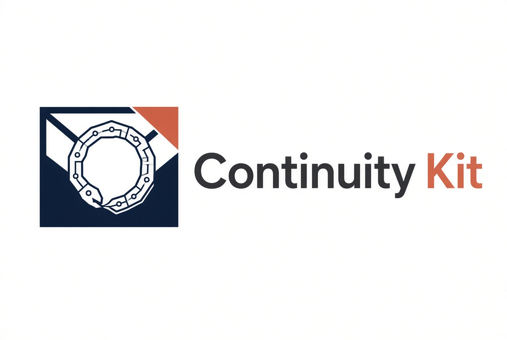

# Continuity Kit



A practical, self-hostable kit for creating a Continuity Packet so the people you trust can act when you cannot.

## Quick Start

1. Open `index.html` in any modern browser (or run the Docker container).
2. Work through the sections in any order. Progress saves automatically in your browser.
3. Use the expandable “What is this…” help on each section if a term is unfamiliar.
4. When ready, click **Download Full Packet (ZIP)**.
5. Print the PDFs, place the break-glass password (and YubiKey if used) in a sealed envelope, and store copies where you indicated.

## What You Get

- Markdown versions of every section (easy to edit later)
- PDF versions suitable for printing and cryptographic signing
- `KeePassXC-Import.csv` for your credential database
- A First-Week Agent Checklist

## Important

- **No data leaves your browser.** Everything is generated locally.
- This is a continuity aid, **not legal advice**. Review the packet with an estate attorney.
- Handwritten personal letters are preferred; the digital fields are a backup.
- Store the master password and any YubiKey only in the sealed envelope — never in the packet itself.

## Run with Docker

```bash
docker build -t continuity-packet-builder .
docker run -p 8080:80 continuity-packet-builder
```

Then open http://localhost:8080

## Moving Progress Between Machines

Use **Export Progress JSON** / **Import Progress JSON** on the Generate page.
